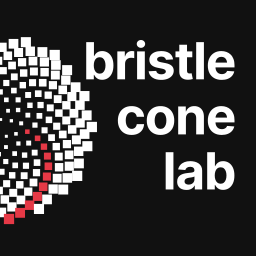
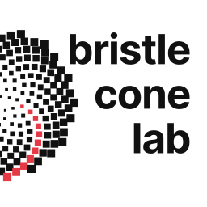
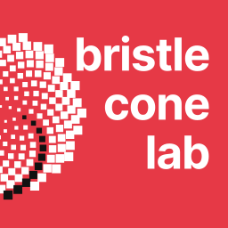
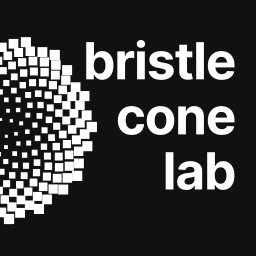
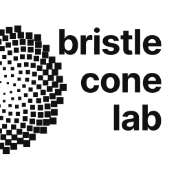

# bristlecone lab brand files

Logos, banner and colours for bristlecone lab.

| Folder | Contents |
| --- | --- |
| [svg/](svg) | Vector masters, text converted to outlines (no fonts needed) |
| [pdf/](pdf) | Vector PDFs for print, Word, Google Docs and LaTeX (`\includegraphics`) |
| [png/](png) | Marks at 1024, 512, 256 and 128 px, lockups, `favicon.ico` |
| [banner/](banner) | Wide banner, 1280x400 and 2560x800, plus the SVG master |
| [avatar.png](avatar.png) | 1024x1024 profile picture |

## Mark

    

| Variant | Use |
| --- | --- |
| dark | Primary: black square, white type, red accent |
| light | Documents on white: white square, black type, red accent |
| red | Stickers and slides |
| mono-black | One colour: stamps, black-and-white print |
| mono-white | One colour on dark: engraving |

## Lockups

| File | Use |
| --- | --- |
| horizontal-on-light, horizontal-on-dark | Letterheads, PDF headers, email signatures, slides |
| stacked-on-light, stacked-on-dark | Posters, title pages, social cards |
| letterhead-A4 | Blank A4 template (PDF and SVG) |

## Colours and type

| Name | Hex |
| --- | --- |
| Ink | `#111111` |
| Paper | `#FFFFFF` |
| Accent red | `#E63946` |
| Grey | `#6B6B6B` |

Typeface: Inter Tight 700 for the wordmark, 500 for the tagline (SIL Open Font License).

Keep at least a quarter of the mark's width clear around it. Smallest size: 24 px on screen, 10 mm in print.

The banner's Earth imagery is rendered from NASA Blue Marble and Black Marble (public domain).
