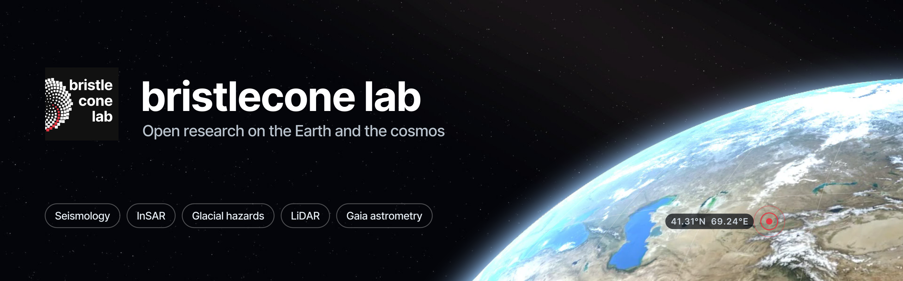

**bristlecone lab** is an independent research group that studies the Earth and the cosmos from open data.
Each project is an atlas you can open in a web browser, with its code and data published alongside it.

### Atlases

| Atlas | What it shows | Built on | Code |
| --- | --- | --- | --- |
| [Global Seismicity Atlas](https://seismicityatlas.org) | Where earthquake catalogues are complete, and the b-value with its uncertainty | ISC-GEM, USGS ComCat | [repo](https://github.com/ismoilovdevml/seismicity-atlas) |
| [Volcano Blind Spots](https://volcano.bristleconelab.org) | Where open GPS and radar data would miss magma building up beneath a volcano | NGL GNSS, Sentinel-1 | [repo](https://github.com/bristleconelab/volcano-detectability) |
| [Seafloor Atlas](https://seaflooratlas.org) | The ocean floor in 3D, and the 30.8% of it that ships have measured | GEBCO 2026 | [repo](https://github.com/ismoilovdevml/seafloor-atlas) |
| [Ocean Life Atlas](https://oceanlife.bristleconelab.org) | The animals and plants recorded in any part of the sea | OBIS, WoRMS, Wikidata | [repo](https://github.com/bristleconelab/ocean-life-atlas) |
| [Cosmic Atlas](https://cosmic.bristleconelab.org) | 39.6 million stars and 15 million galaxies, each at its measured position | Gaia, DESI | [repo](https://github.com/bristleconelab/cosmic-atlas) |

### Preprints

- *A reproducible global atlas of earthquake-catalogue completeness and b-value with uncertainty.*
  EarthArXiv, 2026. [doi:10.31223/X5X23M](https://doi.org/10.31223/X5X23M)
- *Where open geodetic data cannot check for magma accumulation beneath populated active volcanoes.*
  EarthArXiv, 2026. [doi:10.31223/X5C23N](https://doi.org/10.31223/X5C23N)

Work in progress, not yet public: ground deformation from InSAR, glacial lake outburst floods, airborne lidar and Gaia astrometry.

Logos and brand files: [brand/](https://github.com/bristleconelab/.github/tree/main/brand).
Banner imagery from NASA Blue Marble and Black Marble (public domain).
